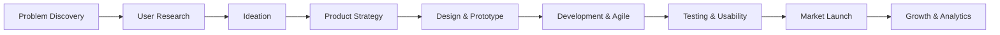

# 🌌 PRODUCTVERSE 3D
### *Think Like a Product Manager. Build Like a Founder.*

[](https://react.dev/)
[](https://www.typescriptlang.org/)
[](https://threejs.org/)
[](https://vitejs.dev/)
[](https://tailwindcss.com/)

**PRODUCTVERSE 3D** is an interactive, futuristic 3D Learning Management System (LMS) and Product Innovation Metaverse where students step into the shoes of Product Managers and learn by conceptualizing, building, prioritizing, and managing virtual software products through their entire lifecycle:



---

## 🏙️ 1. The 3D Virtual Product Metropolis
Explore a futuristic 3D city powered by **Three.js, React Three Fiber, and Drei**:
- **Innovation Lab**: Idea generation, Problem Statements & "How Might We" framing.
- **User Research Centre**: Customer interviews, Empathy Mapping & JTBD personas.
- **Product Strategy Tower**: Product vision, TAM/SAM/SOM market sizing & outcome roadmaps.
- **Design Studio**: Wireframes, UI/UX interaction heuristics & interactive smartphone prototypes.
- **Development Hub**: Agile Scrum ceremonies, sprint planning, Gherkin acceptance criteria & story points.
- **Analytics Centre**: Pirate Metrics (AARRR), DAU/MAU stickiness, cohort retention curves & A/B testing.
- **Launch Arena**: Go-to-market strategies, freemium/tiered pricing & launch campaigns.
- **Growth Centre**: Viral loop engineering, customer feedback iteration & churn prevention.

*Features smooth cinematic camera lerping, neon particle glows, floating billboard HUDs, and an instant toggle between 3D Orbit View and 2D Tactical Grid View.*

---

## 🚀 2. The 10-Step Guided Product Creation Simulator
Students receive a **$100,000 Virtual Development Budget** to take a product from zero to one:
1. **Identify Customer Problem**: Formulate context, root friction, and cost of inaction.
2. **Define User Personas**: Build qualitative profiles with quotes, pain points, and motivations.
3. **Value Proposition Canvas**: Map customer jobs and pains to product pain relievers and gain creators.
4. **RICE Feature Prioritization**: Compute $(Reach \times Impact \times Confidence) / Effort$ scores and MoSCoW tiers.
5. **User Stories & Gherkin BDD**: Write standard stories with concrete `Given-When-Then` acceptance criteria.
6. **Agile Sprint Planning**: Allocate team velocity on a 4-column Kanban board (*To Do, In Progress, Review, Done*).
7. **Interactive Prototype**: Test a live simulated mobile app generated from user stories.
8. **Usability Testing Simulator**: Measure task completion rates, average task duration, and CSAT scores.
9. **Simulated Market Launch**: Choose pricing models and GTM channels, then launch with celebratory confetti.
10. **Live Telemetry & Iteration**: Respond to real-time customer feedback reviews to boost retention and NPS.

---

## 🎮 3. Interactive Executive Product Simulations
Seven realistic, branching PM decision challenges with budget constraints and competitor countermoves:
1. **Food Delivery SuperApp**: Optimize peak-rain courier delivery times using batch routing AI vs subsidies.
2. **E-Commerce Retention Rescue**: Eliminate 72% cart abandonment drop-off and create AI style recommendation feeds.
3. **Next-Gen Fintech Launch**: Balance strict AML/KYC identity verification with progressive, low-friction mobile onboarding.
4. **LMS Onboarding Revamp**: Uncover the "Aha! Moment" by replacing static tooltip tours with personalized learning tracks.
5. **Conversion Rate Crisis**: Troubleshoot checkout funnel drop-offs using cohort slices to fix an iOS Safari Apple Pay failure.
6. **Feature Prioritization Under Pressure**: Defend a 40-point engineering sprint budget against warring stakeholders.
7. **Crisis Management**: Respond to fierce customer backlash following an unpopular UI redesign using transparent communication.

---

## 🤖 4. AI Product Mentor – NOVA
- **Built-in PM Neural Engine**: Operates with **zero latency and 100% offline** with preloaded intelligence across RICE, JTBD, AARRR, MoSCoW, Gherkin, and unit economics.
- **Live AI Mode Toggle**: Optional configuration to connect custom OpenAI or Gemini API keys.
- **Interactive Hologram Interface**: Voice-synthesized audio effects, quick prompt chips, and instant advice.

---

## 🏆 5. Gamification & Career Progression
- **Career Level Hierarchy**:
  - `Product Intern` (0 - 500 XP)
  - `Associate Product Manager` (500 - 1,500 XP)
  - `Product Manager` (1,500 - 3,500 XP)
  - `Senior Product Manager` (3,500 - 6,500 XP)
  - `Product Lead` (6,500 - 10,000 XP)
  - `Chief Product Officer` (10,000+ XP)
- **10 Achievement Badges**: Unlockable milestones (*Discovery Pioneer*, *RICE Master*, *Gherkin Scribe*, *MVP Liftoff*, *Retention Wizard*).
- **Procedural Sound Effects**: Futuristic Web Audio API synthesizer for clicks, warp hums, and level-up chimes.

---

## 👥 6. Multiplayer Squads & Instructor Command Center
- **Multiplayer Roles**: Switch between playing as **Product Manager**, **UI/UX Designer**, **Developer**, **Business Analyst**, or **Product Marketing Manager**, with real-time sprint chat.
- **Instructor Dashboard**: Faculty gradebook, student cohort tracking, course creator, and budget assigner.
- **Offline & Cloud Sync Ready**: Persistent browser storage with JSON backup export/import and optional **Supabase cloud sync integration**.

---

## 💻 Tech Stack
- **Frontend**: React 19, TypeScript, Vite 6, Tailwind CSS 4
- **3D Graphics**: Three.js, React Three Fiber, React Three Drei
- **Icons & UI**: Lucide React, Canvas Confetti
- **Audio**: Web Audio API Procedural Synthesizer
- **Backend / Storage**: LocalStorage Persistence, Supabase Sync Ready

---

## 🏃 Getting Started

### Prerequisites
- Node.js 18+ (Node 20+ LTS recommended)
- npm or yarn

### Installation
```bash
# Clone the repository
git clone https://github.com/camiesondhi-bit/productverse-3d.git
cd productverse-3d

# Install dependencies
npm install

# Start development server
npm run dev
```

Visit `http://localhost:3000` in your browser.

### Production Build
```bash
npm run build
npm run preview
```

---

*PRODUCTVERSE 3D – Where every student becomes a Product Builder.*
